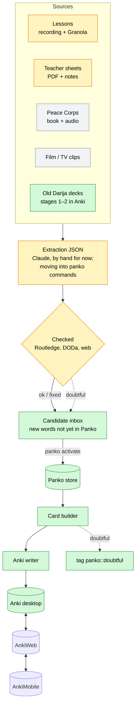
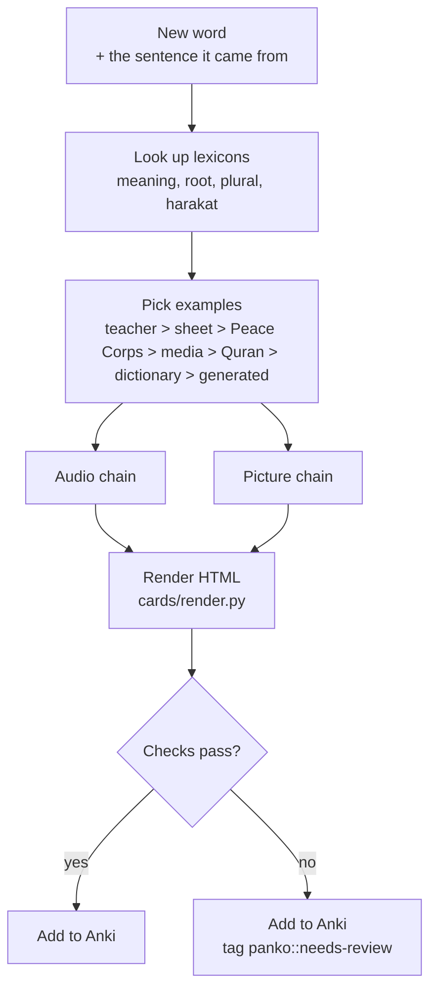
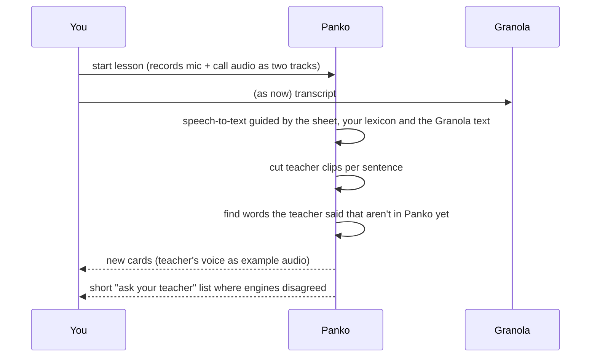

# Panko architecture

Five diagrams, from the big picture down. Each one is small on purpose. To change the
stack, point at a box and say what you want, e.g. *"swap Azure for Google in the audio
chain"* or *"add YouTube as a source"*. Box names match names in the code and in
`config/panko.toml`.

**Legend.** Green = built. Amber = partly built or stubbed. Grey = planned.

## 1. The big picture



Panko is a separate app that writes into your real Anki collection. It is not a
fork, so whatever it writes syncs to AnkiMobile like any other card.

## 2. Who does what (the swappable stack)

Each job has a **chain**: Panko tries providers left to right and uses the first one
that returns a result. Providers without an API key in `.env` are skipped. The order
lives in `config/panko.toml`, so changing it needs no code.

```mermaid
flowchart TB
    subgraph Audio["Audio (word + examples)"]
        direction LR
        a1[native<br/>teacher clip / Peace Corps]:::part --> a2[ElevenLabs v3<br/>Darija: Badr + Ghalia<br/>Fusha: George]:::built --> a3[Azure<br/>ar-MA / ar-SA]:::part
    end
    subgraph Pictures
        direction LR
        p1[source<br/>crop from the PDF/clip]:::part --> p2[Wikimedia Commons]:::built --> p3[Openverse]:::built --> p4[generate<br/>gpt-image-2 drawings<br/>now or batch]:::built
    end
    subgraph Text["Writing + checking"]
        direction LR
        t1[Lexicons<br/>Wiktionary, Qabas, DODa, Lane]:::plan --> t2[Claude<br/>drafts entry]:::plan --> t3[CAMeL Tools<br/>checks harakat + morphology]:::plan
    end
    subgraph LLM["Language model (panko.llm: estimate, budget, cache, batches)"]
        direction LR
        l0[Prompts<br/>src/panko/prompts + config learner/evidence]:::built --> l1[Claude<br/>Opus 5.5, structured JSON,<br/>vision, batches]:::built --> l2[OpenAI<br/>chat, once a model is set]:::part
    end
    subgraph Speech["Lesson speech-to-text"]
        direction LR
        s1[Gemini]:::plan ~~~ s2[ElevenLabs Scribe]:::plan ~~~ s3[Whisper fine-tune]:::plan
    end
    subgraph Anki["Anki access"]
        direction LR
        k1[MCP add-on<br/>Anki open]:::built ~~~ k2[pylib<br/>Anki closed, migrations]:::built
    end

    classDef built fill:#d3f9d8,stroke:#2b8a3e,color:#000
    classDef part fill:#fff3bf,stroke:#e67700,color:#000
    classDef plan fill:#f1f3f5,stroke:#868e96,color:#000
```



Speech-to-text engines and the two Anki paths aren't chains (no arrows). The speech engines run side by side: where they disagree, Panko
flags the word for your teacher.

## 3. Building one card



Where something came from is shown only in the collapsed **Sources** section. The
card body looks the same whatever the source.

## 4. Lesson capture



## 5. Where data lives

```mermaid
flowchart LR
    db[(Panko store<br/>data/panko.db<br/>entries, sources, sightings)]:::built -- render + sync in place --> n[Anki note fields]:::built
    n -. your edits, e.g. MyNotes .-> db
    med[data/media<br/>pictures + credits]:::built --> n
    cfg[config/panko.toml<br/>.env keys]:::built --> db

    classDef built fill:#d3f9d8,stroke:#2b8a3e,color:#000
    classDef plan fill:#f1f3f5,stroke:#868e96,color:#000
```

The dotted arrow is planned: reading your Anki edits back into the store. Panko's store is the source of truth for everything it generates. The panel fields
(`ExamplesHTML`, `LinksHTML`, ...) are re-rendered from it, so a design change
reaches every card without touching review history. Panko never writes `MyNotes`.

## Code map

| Path | What |
|---|---|
| `config/panko.toml` | provider chains and settings |
| `src/panko/providers/` | one file per provider, registered by name |
| `src/panko/llm.py` | runs language-model work for every command: cost estimate, budget cap, answer cache (`cache/llm/`), usage log (`data/llm-usage.jsonl`), half-price batches (`panko llm collect`) |
| `src/panko/providers/llm/` | `claude.py` (Anthropic SDK: JSON schema output, vision, prompt caching, token counting, batches, refusal fallbacks), `openai_chat.py` |
| `src/panko/prompts/` | generic prompts (`*.md`, `{{var}}`, `{{#var}}…{{/var}}`, `{{> part}}`) filled from `[learner]` and `[evidence]` in config; `schemas.py` holds the strict JSON schema per prompt; `prompts.ask(name, id, parts)` builds the request for `llm.run` |
| `src/panko/cards/note_types.py` | Anki fields, card templates, CSS |
| `src/panko/cards/render.py` | entry data → card HTML |
| `src/panko/anki/mcp_client.py` | talks to the Anki MCP Server add-on |
| `src/panko/media/pictures.py` | the picture step (`panko pictures export/search/apply`): photo candidates + contact sheets, applying decisions, drawings now (`draw`) or by OpenAI batch (`draw_batch`, `collect`) |
| `src/panko/media/audio.py` | walks the audio chain, caches results in `cache/media/` |
| `src/panko/store/` | SQLite store: entries, sources, sightings, Anki links; Arabic normalisation for dedup |
| `src/panko/ingest/` | extraction JSON → candidates (inbox); `activate` promotes them |
| `src/panko/ingest/verify.py` | applies check verdicts + overrides to items before ingest |
| `src/panko/cards/build.py` | store entry → Anki note (fields, deck, tags, audio) |
| `src/panko/anki/sync.py` | pushes models, media and notes; updates changed notes in place |
| `src/panko/anki/migrate.py` | Phase 6 (`panko migrate [ids] [--apply]`): studied old-deck notes → Panko notes in place via the `anki` library, Anki closed; dry run by default |
| `src/panko/sandbox/seed.py` | the 9 hand-written sandbox entries (`panko seed`) |
