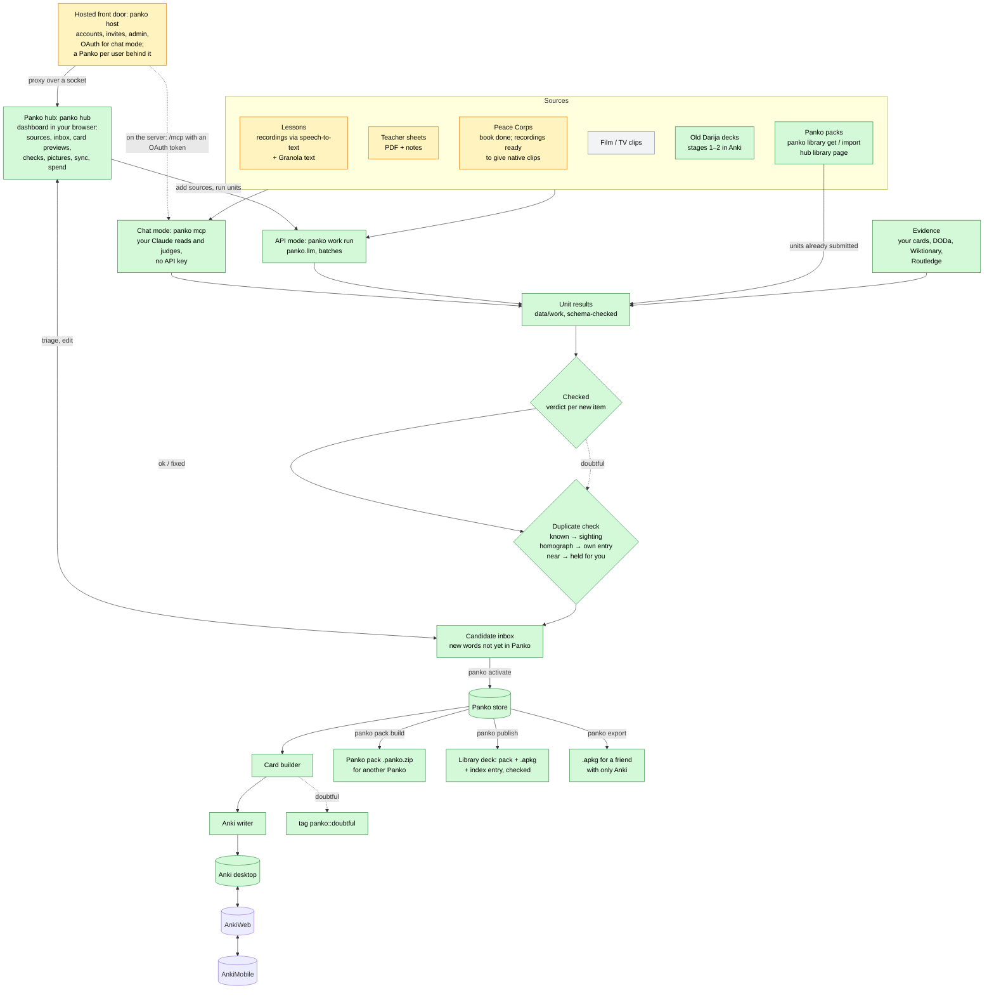
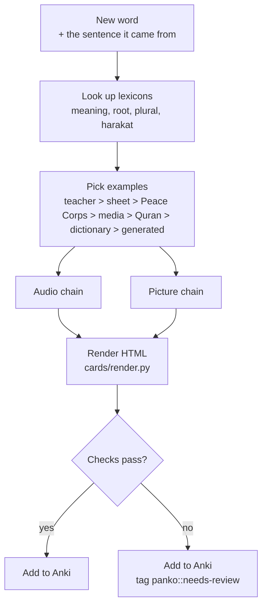

# Panko architecture

Five diagrams, from the big picture down. Each one is small on purpose. To change the
stack, point at a box and say what you want, e.g. *"swap Azure for Google in the audio
chain"* or *"add YouTube as a source"*. Box names match names in the code and in
`config/panko.toml`.

**Legend.** Green = built. Amber = partly built or stubbed. Grey = planned.

## 1. The big picture



Panko is a separate app that writes into your real Anki collection. It is not a
fork, so whatever it writes syncs to AnkiMobile like any other card.

## 2. Who does what (the swappable stack)

Each job has a **chain**: Panko tries providers left to right and uses the first one
that returns a result. Providers without an API key in `.env` are skipped. The order
lives in `config/panko.toml`, so changing it needs no code.

```mermaid
flowchart TB
    subgraph Audio["Audio (word + examples)"]
        direction LR
        a1[native<br/>clips cut from recordings]:::built --> a2[ElevenLabs v3<br/>Darija: Badr + Ghalia<br/>Fusha: George]:::built --> a3[Azure<br/>ar-MA / ar-SA]:::part
    end
    subgraph Pictures
        direction LR
        p1[source<br/>crop from the PDF/clip]:::part --> p0[Wikidata<br/>item's own Commons picture]:::built --> p2[Wikimedia Commons]:::built --> p3[Openverse]:::built --> p5[Pexels<br/>free key]:::built --> p6[Pixabay<br/>free key]:::built --> p4[generate<br/>gpt-image-2 drawings<br/>now or batch]:::built
        p7[iNaturalist<br/>animals, plants<br/>off by default]:::part ~~~ p8[ARASAAC<br/>pictograms, CC BY-NC-SA<br/>off by default]:::part
    end
    subgraph Text["Writing + checking"]
        direction LR
        t1[References<br/>DODa, Wiktionary, Routledge<br/>dialect grounding]:::built --> t2[Claude<br/>check prompt, with readings<br/>as evidence]:::built --> t3[CAMeL Tools<br/>Fusha harakat, root, forms<br/>panko verify, at ingest]:::built --> t4[CATT<br/>second vote on harakat]:::plan
    end
    subgraph LLM["Language model (panko.llm: estimate, budget, cache, batches)"]
        direction LR
        l0[Prompts<br/>src/panko/prompts + config learner/evidence]:::built --> l1[Claude<br/>Opus 5.5, structured JSON,<br/>vision, batches]:::built --> l2[OpenAI<br/>chat, once a model is set]:::part
    end
    subgraph Speech["Speech-to-text (recordings → words with times)"]
        direction LR
        s2[ElevenLabs Scribe<br/>word times, speakers]:::built --> s1[Gemini]:::plan --> s3[Whisper fine-tune]:::plan
    end
    subgraph Anki["Anki access"]
        direction LR
        k1[MCP add-on<br/>Anki open]:::built ~~~ k2[pylib<br/>Anki closed, migrations]:::built ~~~ k3[Panko sync add-on<br/>from the server]:::built
    end
    subgraph Language["Language (panko.lang, from learner in config; presets for panko init)"]
        direction LR
        g0[Presets<br/>Moroccan Darija, Spanish]:::built --> g1[Script<br/>check at submit, card font + direction]:::built --> g2[Matching keys<br/>case, articles, marks]:::built --> g3[Arabic rules<br/>harakat, ال, clitics, hamza]:::built
    end

    classDef built fill:#d3f9d8,stroke:#2b8a3e,color:#000
    classDef part fill:#fff3bf,stroke:#e67700,color:#000
    classDef plan fill:#f1f3f5,stroke:#868e96,color:#000
```



The two Anki paths aren't a chain (no arrows). Speech-to-text is a chain like the others: the first ready engine
transcribes. Running two engines side by side and flagging the words they disagree on for your teacher is planned.

## 3. Building one card



Where something came from is shown only in the collapsed **Sources** section. The
card body looks the same whatever the source.

## 4. Lesson capture

```mermaid
sequenceDiagram
    participant You
    participant Panko
    participant STT as Speech-to-text
    participant Reader as Reader (your Claude or panko.llm)
    You->>Panko: work add lesson.m4a [--track call.m4a] --speakers teacher,me --learner me
    Panko->>STT: work transcribe (paid; or --transcript you already have)
    STT-->>Panko: every word with its time and speaker
    Panko->>Reader: 3-minute units: "[m:ss] teacher: …"
    Reader-->>Panko: items, checked, with pictures planned
    Panko->>Panko: ingest: duplicates, then a clip of each word and sentence the recording says (never your voice)
    Panko-->>You: new cards that play the real speaker
```

Recording the lesson itself (mic and call audio as two tracks) is up to you for now; record only with your
teacher's consent. Guiding speech-to-text with the sheet and your lexicon, and a second engine to compare, are planned.

## 5. Where data lives

```mermaid
flowchart LR
    db[(Panko store<br/>data/panko.db<br/>entries, sources, sightings)]:::built -- render + sync in place --> n[Anki note fields]:::built
    n -. your edits, e.g. MyNotes .-> db
    med[data/media<br/>pictures + credits]:::built --> n
    cfg[config/panko.toml<br/>.env keys]:::built --> db

    classDef built fill:#d3f9d8,stroke:#2b8a3e,color:#000
    classDef plan fill:#f1f3f5,stroke:#868e96,color:#000
```

The dotted arrow is planned: reading your Anki edits back into the store. Panko's store is the source of truth for everything it generates. The panel fields
(`ExamplesHTML`, `LinksHTML`, ...) are re-rendered from it, so a design change
reaches every card without touching review history. Panko never writes `MyNotes`.

## Code map

| Path | What |
|---|---|
| `config/panko.toml` | provider chains and settings (yours); `src/panko/templates/panko.example.toml` (shipped in the package) is the generic template `panko init` fills |
| `src/panko/config.py` | finds the Panko folder (`find_root`: `PANKO_HOME`, else the nearest folder up with `config/panko.toml`, else the checkout); loads config and `.env`, with the hub's choices in `config/hub.toml` laid over `config/panko.toml` (`save_choices`); `anki()` / `deck()` / `collection_path()` with defaults; hosted mode (`hosted()`, `inside()` for paths, `public_url()`, `host_limits()` and `room_for()` for the quota) |
| `src/panko/setup.py` | `panko init [--language L]`: starter config from answers plus the language's preset (`src/panko/templates/languages/*.toml`: script, prompt wording, references, speech-to-text language, voices), and the readiness check (`--check`) |
| `src/panko/lang/` | everything about the language being learned, from `[learner]`: its script (Unicode script names; checked at submit; card font and direction, `card_css`), matching keys for any script (case, NFC, configured articles, optional mark folding), list splitting, and the comparison with analyser readings; `arabic.py` holds the Arabic rules (harakat, alef, ال, clitics, hamza seats, shadda), which touch Arabic letters only |
| `src/panko/providers/` | one file per provider, registered by name |
| `src/panko/providers/images/` | picture search: `wikidata.py` (query → Wikidata item → its P18 Commons file), `commons.py`, `openverse.py`, `pexels.py`, `pixabay.py` (free keys), `inaturalist.py`, `arasaac.py` (off by default), `source.py` (crops, not built); `web.py` = polite spacing per site, one retry on 429 then pause the site, answers cached in `cache/images/` |
| `src/panko/library.py` | Panko packs (`panko pack build`, `panko library import`): a deck as one zip another Panko imports; import registers it as a work source of type `pack` with units already submitted, so `work.ingest_source` decides each card; `publish` adds the checks for the public library (picture licences, private sentences and names), the .apkg built from the pack, the index entry and a report; `decks`/`get` read the library's index and download a deck, sha256-checked, into `[library] dir` (docs/SPEC-library.md) |
| `src/panko/modes.py` | chat mode or API mode: each MCP tool call is noted in `data/work/chat.json` (recent = connected), API mode is ready when the `llm` chain has a provider; the hub's status bar and setup page show both |
| `src/panko/mcp_server.py` | chat mode (`panko mcp`, `--config` prints the Claude Desktop/Code snippet): thin MCP tools over the modules below; the workflow Claude follows is `prompts/chat.md` (`panko_guide`). `http_app()` serves the same tools at `/mcp` in a hosted Panko; expected errors reach Claude as `ToolError`s with their reason |
| `src/panko/host/` | the front door of a hosted Panko (`panko host serve\|invite\|users\|purge`, docs/SPEC-hosted.md, deploy/): `store.py` (users, one-time invites, sessions in `<data>/host.db`; tokens stored as hashes, passwords argon2), `pankos.py` (each user's own `panko hub --socket` with `PANKO_HOME` set to their folder, a small environment, started on demand, stopped when idle unless a job runs), `app.py` (sign-in, invites, account, admin, data export as a zip, the public install page `/host/install` for Panko on your own computer; everything else proxied to the user's Panko with the front-door secret, without the session cookie; POSTs must come from this site), `pages.py` (plain HTML, no script), `watch.py` (health for `/host/health`, events on the admin page, alerts to `PANKO_ALERT_URL`, everyone's disk use against their quota every hour), `oauth.py` (chat mode: the OAuth 2.1 server for the learner's Claude, with registration, PKCE, consent and rotating tokens; `/mcp` passed to their Panko on an access token only), `cli.py` |
| `src/panko/hub/` | the local dashboard (`panko hub`, 127.0.0.1 only; on the server `--socket PATH` behind the front door): `__init__.py` (app, guard: Host check, key from the printed link as an HttpOnly cookie, or the front door's secret on a socket; `X-Panko` header on changes; uploads, with a size limit and quota on the server), `api.py` (JSON routes over the modules below; long or paid steps as jobs, paid ones estimate first and need `confirm` and a budget), `jobs.py` (one at a time, output captured per job, kept across restarts in `data/work/jobs.json` with the request that started each, so an interrupted one can be replayed: `api.resume`), `preview.py` (a card as Anki shows it: templates filled, media inline, sandboxed with a load-nothing policy; it reports its height, flips on a click and passes keys up), `static/` (terminal-styled single page, plain JS, no build step: pages, card design, voice picker, walkthrough) |
| `src/panko/work.py` | sources split into units (PDF pages, photos, transcript chunks, 25-row stretches of an exported deck, 3-minute stretches of a transcribed recording: `transcribe`, `transcript.json`), one validated result per unit in `data/work/<source>/units/`, resumable; `ingest_source` merges results: known → sighting + the source's sentences, homograph → own entry with shadda, near-duplicate → held |
| `src/panko/pipeline.py` | API mode (`panko work run [--batch] [--budget] [--estimate]`): extract → local evidence → check → picture plan per unit through `panko.llm`, then `work.submit` like a chat result; deck units: local evidence (rows you have become known) → `deck` prompt (extract + check in one) → picture plan |
| `src/panko/evidence.py` | free local evidence per word: the learner's entry, same-letter words, near-duplicates, hits from `[evidence]` corpora and dictionaries (read by file shape, target column by script or `columns`, token-indexed once), the `[morph]` analyser's readings for varieties that have one; `download()` fetches the open ones (`panko refs --download`) |
| `src/panko/dedupe.py` | duplicate checks: transliteration consonant skeletons (ضحك d7ek ≠ ضحّك de77ek), shadda insertion, fuzzy near-duplicate index |
| `src/panko/llm.py` | runs language-model work for every command: cost estimate (output size measured per task from the usage log), budget cap, answer cache (`cache/llm/`), usage log (`data/llm-usage.jsonl`), half-price batches (`panko llm collect`) |
| `src/panko/providers/llm/` | `claude.py` (Anthropic SDK: JSON schema output, vision, prompt caching, token counting, batches, refusal fallbacks), `openai_chat.py` |
| `src/panko/prompts/` | generic prompts (`*.md`, `{{var}}`, `{{#var}}…{{/var}}`, `{{> part}}`) filled from `[learner]` and `[evidence]` in config; `schemas.py` holds the strict JSON schema per prompt; `prompts.ask(name, id, parts)` builds the request for `llm.run` |
| `src/panko/cards/note_types.py` | Anki fields, card templates, CSS (`css()`: the script's font and direction for `.tgt` text, per variety via `data-v="{{Register}}"`) |
| `src/panko/cards/render.py` | entry data → card HTML |
| `src/panko/cards/design.py` | card design: which sections the back shows and in what order, fronts, sizes, fonts, your CSS, your own sections in Spare1–4 (`[cards]`, set in the hub); templates and CSS only, never the field list |
| `src/panko/anki/mcp_client.py` | talks to the Anki MCP Server add-on |
| `src/panko/media/pictures.py` | the picture step (`panko pictures export/search [--providers …]/apply`): photo candidates taken in turn from each site + contact sheets (10 per row, site-tagged), applying decisions, drawings now (`draw`) or by OpenAI batch (`draw_batch`, `collect`) |
| `src/panko/media/audio.py` | walks the audio chain, caches results in `cache/media/` |
| `src/panko/media/voices.py` | the hub's voice picker: the ElevenLabs library by language, accent and gender, samples, and saving the chosen voices (a library voice is added to the account first) |
| `src/panko/checks.py` | deterministic checks (`panko verify`, `panko_verify`, and at ingest): headword, forms, root, POS and example words of a variety with a `[morph]` analyser against its readings (for Arabic, harakat a subset), hard problems → `panko::doubtful`; other varieties' words without a reference hit listed (`ungrounded`) |
| `src/panko/providers/morph/` | morphology chain (`[morph]`): `camel.py` runs CAMeL Tools in any environment that has it (helper over stdin, `PANKO_CAMEL_PYTHON`), readings cached in `cache/morph/` |
| `src/panko/media/clips.py` | native clips: finds where a recording says an item (word times, article-tolerant, never the learner's voice), cuts it with ffmpeg to `data/media/`, and indexes it by text (`data/media/native.json`) for the `native` audio provider |
| `src/panko/providers/stt/` | speech-to-text chain (`[stt]`): `elevenlabs.py` (Scribe: word times, diarized speakers, language forced from config) |
| `src/panko/store/` | SQLite store: entries, sources, sightings, Anki links; matching keys from `panko.lang` |
| `src/panko/ingest/` | extraction JSON → candidates (inbox); `activate` promotes them |
| `src/panko/ingest/verify.py` | applies check verdicts + overrides to items before ingest |
| `src/panko/cards/build.py` | store entry → Anki note (fields, deck, tags, audio) |
| `src/panko/media/reuse.py` | pictures you already have: matched by meaning (main sense of the gloss, part of speech); offered first in every photo search (the `yours` provider, `[images] reuse`), as the pictures page's reuse list (other varieties only, clear matches ticked), and in the chooser with the photos found for the matching card; a reused picture shares the same file. Each picture records `provider`, `meaning`, `page`, `license`, `item` and `reused_from` |
| `src/panko/media/choose.py` | choosing a picture per card (`panko pictures decide`, chat tools `panko_pictures_todo` / `panko_photo_search` / `panko_pictures_save` / `panko_pictures_apply`): saved or `pictures-plan` plans → photo search (earlier search folders reused) → `pictures-pick` on each contact sheet → decisions in `data/pictures/decisions.json` |
| `src/panko/examples.py` | `panko examples`: example sentences for words without one, from sightings and corpus sentences (`evidence.sentences`) via the `examples` prompt; `add()` is shared with chat mode's `panko_examples_save` and the hub's examples page |
| `src/panko/clashes.py` | `panko clashes` / `panko_clashes`: production cards whose glosses share a sense → keep, sharpen, recognition-only or drop (never removes a card already in Anki) |
| `src/panko/anki/export.py` | `panko work add --deck NAME`: read-only export of an Anki deck (studied notes marked) as a source |
| `src/panko/skill.py` | `panko mcp --skill DIR`: the chat workflow as a Claude skill (`SKILL.md`) |
| `src/panko/anki/apkg.py` | `panko export` and the hub's "share as a file": active cards as an .apkg built in a scratch collection with Anki's library (no scheduling, MyNotes empty, sources and lesson clips only with `personal`; note guids and note type ids fixed so a newer package updates the old one); `package()` writes any rendered notes, and `library.publish` uses it for a deck's .apkg |
| `src/panko/anki/sync.py` | pushes models, media and notes; updates changed notes in place; `plan()` is the dry run (`panko sync --dry-run`: notes to add/update, audio still to pay for) |
| `src/panko/anki/remote.py` | the server's side of the Panko sync add-on: `pull` (this Panko's own note types and the notes new or changed since the add-on wrote them, in rounds), `media_file`, `done` (the store's `anki` links) |
| `src/panko/mcpb/` | chat mode as a Claude Desktop extension (`panko.mcpb`): a "uv" bundle (manifest, icon, `pyproject.toml` pinning this `pankohub` release, `src/server.py` running `panko mcp`), built on demand for the hub's setup page, the front door's install page and `panko mcp --bundle` |
| `src/panko/anki_addon/` | the Anki add-on ("Panko sync", downloaded from the hub as an .ankiaddon): `core.py` writes through Anki's library (note types made or refused, notes added or updated in place, never MyNotes, one undo step), `net.py` talks to the user's Panko on a device code (a hosted one) or the lasting code a local hub's sync page makes, over http on 127.0.0.1, `ui.py` the Tools menu and settings; `src/panko/anki/addon.py` zips it for download |
| `src/panko/anki/migrate.py` | Phase 6 (`panko migrate [ids] [--apply]`): studied old-deck notes → Panko notes in place via the `anki` library, Anki closed; dry run by default |
| `src/panko/sandbox/seed.py` | the 9 hand-written sandbox entries (`panko seed`) |
