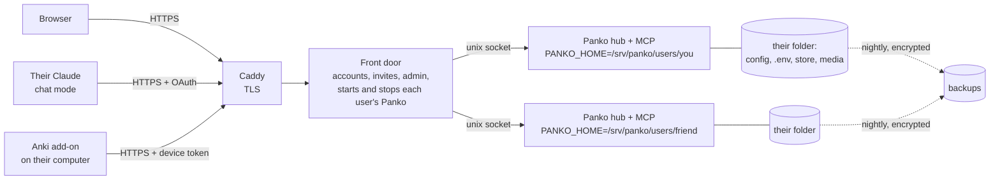

# Hosted Panko (S10 step 3)

**Goal:** Panko on a server, so you and a few people you invite use it in the browser, with nothing to install
but a small Anki add-on. Each person builds their own deck from their own sources, exactly as with the local hub.

Settled (your call, 2026-11-26):
- **Who:** you plus a few invited people. Accounts and separate data from day one; no public sign-up.
- **Model costs:** each user's own. They add their own API key (API mode) or connect their own Claude (chat mode,
  free for them). Nothing is paid for on their behalf.
- **Into Anki:** a small local helper: an **Anki add-on** that pulls each user's cards from the server.
- **Where:** one small Linux server with a disk for everyone's media, HTTPS, your own domain.
- **A website first** (your call, 2026-11-26), not a desktop or phone app. A desktop app would reach Anki and
  record calls directly, but means an installer per system and no phone; today's local Panko already serves anyone
  who wants everything on their own machine. Later, if wanted: the website installable on phones (a web app on the
  home screen, for photographing sheets and recording in-person lessons) and a menu-bar recorder that notices a
  lesson call and sends both tracks to the user's Panko.

## Shape

**One Panko process per user.** Panko assumes one folder per process: every path is fixed at startup from
`PANKO_HOME`, settings and reference look-ups are cached for the process, and keys from a folder's `.env` go into
the process environment. Making all of that per-request would touch most modules. Instead, the front door starts a
user's own Panko (hub and MCP server) with `PANKO_HOME` set to their folder, on a Unix socket only it can reach, and
stops it after 20 idle minutes. With a few users this is cheap (one Python process is roughly 150–250 MB while
running), and it isolates them completely: one user's key, store or job can't reach another's.

**The front door** is a small new app in this repo (`src/panko/host/`):
- **Accounts.** Invite links you make on an admin page; the invited person picks a password (argon2), passkeys
  later. Sessions in a signed cookie. No email sending needed at first: you send the link yourself.
- **Proxy.** `/` and `/api/*` go to the user's hub, `/mcp` to their MCP server, `/anki/*` to their hub's add-on
  routes. The hub trusts the front door's socket instead of its own launch token.
- **Admin** (you only): invite, disable, see disk use and last activity per user, export or delete a user.
- **OAuth for chat mode.** Claude's custom connectors sign in with OAuth, so the front door is the authorisation
  server for each user's `/mcp` (the MCP authorisation spec). Claude Code can also use a personal token header.

## Hosted mode inside Panko (`PANKO_HOSTED=1`) ✅ H1

What changes when a Panko process runs on the server instead of your computer:

| Today (local) | Hosted |
|---|---|
| The hub answers only on 127.0.0.1, with a token in the launch link | Listens on a Unix socket; the front door has already checked who you are |
| Sources by upload, by path or from your Anki | By upload only. A typed path, or any stored path, outside the user's folder is refused (`work._abs` today accepts any absolute path) |
| Keys in `.env`, "restart the hub" | Keys entered on the setup page, written to that user's `.env` (readable only by Panko), and their Panko is restarted for them |
| `[export] dir`, `[library] dir` anywhere | Fixed inside the user's folder; exports and decks are downloads |
| "Open the folder / config" buttons | Hidden. The config is edited on the setup page, and absolute paths aren't shown |
| Uploads of any size | A size limit per upload and a disk quota per user, set by the front door (`PANKO_UPLOAD_MB`, `PANKO_QUOTA_GB`; the user's own config can't raise them), shown on the setup page |
| Sync talks to the Anki add-on on 127.0.0.1:3141 | Refused until H3; the .apkg download is the way to Anki. Then "Prepare" renders cards and makes audio on the server (estimate first, the user's ElevenLabs key) and the Anki add-on pulls the result |
| SQLite as is | WAL mode and a busy timeout, since the hub and the MCP server write to the same store (the timeout locally too; WAL only on the server, so copying `panko.db` stays a whole backup locally) |
| Paths and URLs in your config are yours | Reference paths outside the folder go to `cache/refs`; URLs (references, a library index, deck files) must be public https; the CAMeL Tools interpreter and its data are the server's (`PANKO_CAMEL_PYTHON`, `CAMELTOOLS_DATA` in the environment) |

**DODa stays on (your call, 2026-11-26).** A free, invite-only service is within DODa's personal, research and
educational terms. Each user's Panko downloads it into their own folder as today (`panko refs --download`). If its
authors ever object, it is switched off on the server (`[refs]` in the users' config) and the evidence step goes on
with Wiktionary, the course book and each user's own references.

**How it's built (H1).** `config.hosted()` reads `PANKO_HOSTED`; `config.inside()` keeps a path in the folder
(`work._abs`, sources, transcripts, tracks, references, a local library index); `config.public_url()` checks URLs;
`config.room_for()` checks the quota. `panko hub --socket PATH` binds the socket itself (mode 600, a stale one
replaced, a live one left alone) and refuses to start without `PANKO_FRONT_SECRET` (16+ characters); the front door
sends it as `X-Panko-Front` and must strip any copy a browser sends. Put the sockets in a folder only the Panko
user can enter. Answers on the server have the folder's path removed (`api._json`). Keys: `GET/POST /api/setup/keys`
(names from `env.example`, values never returned); config: `POST /api/setup/text` (checked as TOML, `.bak` kept).

Unchanged: the store, ingest, checks, pictures, the library, card design, voices, jobs (one at a time per user),
budgets and spend (per user, since each has their own folder). Free photo sites use the server's own Pexels and
Pixabay keys unless a user adds theirs. Speech-to-text, CAMeL Tools, poppler and ffmpeg are installed on the server.

## The Anki add-on ("Panko sync")

The cards are rendered on the server (the same `cards.build` as today), so the add-on only writes what it's given.
Small, and it never decides anything about a card.

- **Pairing:** the hub's sync page makes a device token; the user pastes it with the server's address into the
  add-on's settings. A token can be revoked from the hub.
- **Sync now** (Tools → Panko, and optionally when Anki starts):
  1. Ask the server what changed since the last sync: note types (templates, CSS; fields are fixed), notes to add
     or update (guid, Panko id, note type, deck, fields, tags) and the media they use.
  2. Download the media it doesn't have.
  3. Write the notes through Anki's own collection API: add new ones, update fields and tags in place.
  4. Report back which Anki note holds each Panko id, so the store's `anki` table stays right.
- **The rules stay the rules:** it only touches the user's Panko decks and note types; it never writes MyNotes; it
  never deletes a note or changes scheduling; it refuses a note type whose fields don't match instead of changing
  them (no full sync, ever, from the add-on); a note it finds by guid is updated, never copied.
- **Phones:** AnkiMobile can't run add-ons, so it gets the cards the usual way: desktop Anki syncs to AnkiWeb.
- **Shipping:** an `.ankiaddon` file from the hub at first; on AnkiWeb's add-on list once it's settled.
- **Moving your own Panko later:** your notes are already in the `anki` table with their note ids, so the add-on
  updates them in place. Tried on a copy of your collection in a scratch profile first, never on the real one
  without your OK.

## Server

- **One small server** (2 vCPU, 4 GB, roughly €5–15 a month with a separate disk for media), Docker Compose with
  Caddy (HTTPS from Let's Encrypt) and one image holding Panko, the front door, poppler, ffmpeg and CAMeL Tools.
- **Data:** `/srv/panko/users/<id>/` per user, on the separate disk. The image holds no user data.
- **Backups:** nightly and encrypted (restic) to separate storage, 30 days kept, and a restore tried before anyone
  is invited.
- **Updates:** a new image, then each user's Panko picks it up when it next starts.

**Why not Vercel, Supabase or Cloudflare Workers.** Panko needs long-running Python processes (a source read or a
sync takes minutes), a real disk (a SQLite store and hundreds of MB of media per user) and native tools (ffmpeg,
poppler, CAMeL Tools). Serverless platforms give short-lived functions with no lasting disk, so Panko would have to
be rewritten around a hosted database and object storage. Supabase is a database, auth and storage service rather
than a place to run Panko. Cloudflare is still useful *in front*: DNS, and a Cloudflare Tunnel so the server
opens no ports. If you'd rather not look after a server, Fly.io (machines with volumes, started on demand) or
Render or Railway (with a persistent disk) run the same image; a plain server (e.g. Hetzner) is the cheapest and
simplest.

## Privacy and the invited

Invited users bring lesson recordings, teacher sheets and their teachers' voices. A short page for them says what
is stored, that you (the admin) could technically read it, that keys are theirs and spend is theirs, how to export
everything (their folder as a zip) and how to delete it all. Recording a lesson still needs the teacher's consent.

## Build order

| Step | What "done" means |
|---|---|
| H1 ✅ | **Hosted mode inside Panko.** `PANKO_HOSTED=1`: socket listening, paths kept inside the folder, keys on the setup page, local-only buttons hidden, upload limits and quota, WAL. Tested locally with two folders side by side. |
| H2 | **Front door and the server.** Accounts and invites, a Panko per user started and stopped on demand, the proxy, admin, export and delete. Deployed with Caddy and backups (restore tried). You use it first, then one invited person. |
| H3 | **The Anki add-on.** The server's add-on routes and the add-on itself, tested against a scratch Anki profile. Then your own Panko moves to the server if you want it there. |
| H4 | **Chat mode remotely.** Each user's MCP server over HTTP behind the front door, with OAuth so their Claude (claude.ai, the desktop app, Claude Code) connects as a custom connector. |
| H5 | **Polish.** Jobs that survive a restart, quota warnings, invite emails, simple monitoring. |

## Open
- **Domain name** for the server, and which provider.
- **Server-wide photo keys:** the front door gives every Panko the server's Pexels and Pixabay keys in its
  environment; a user's own key, saved on the setup page, wins until their Panko restarts, then the server's does
  (`load_dotenv` doesn't override). Settle in H2: pass the server's keys under other names as a fallback.
- **Your Claude's own URL:** `[llm] base_url` in a user's config sends their own key wherever they point it. Their
  key, their choice, but it is also a request from the server; H2 may limit it to Anthropic's API.
- **Whether your own Panko moves** to the server (H3) or stays on your Mac.
- **Spend limits:** each user's `[llm] budget_usd` applies per run; a monthly cap per user may be wanted later.
